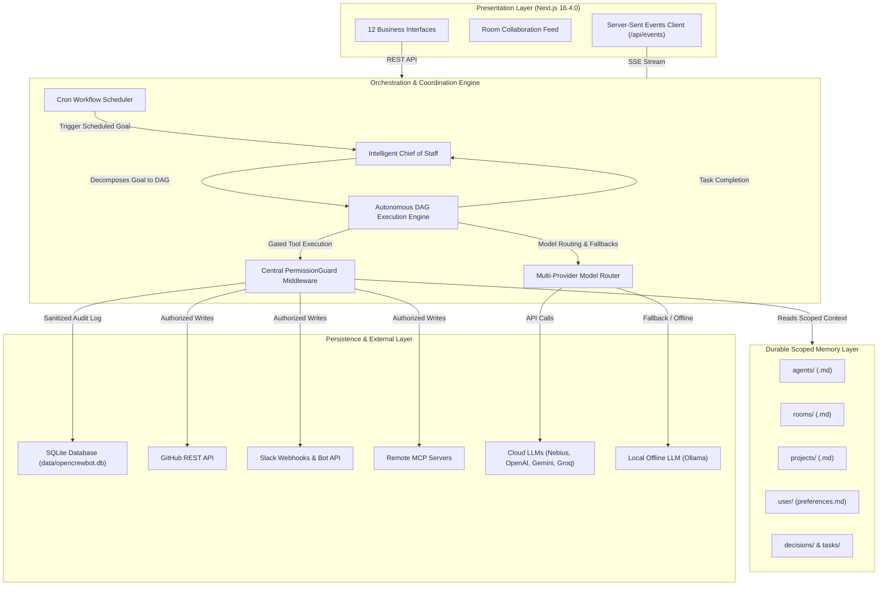
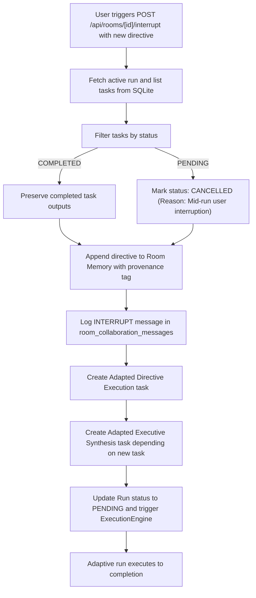
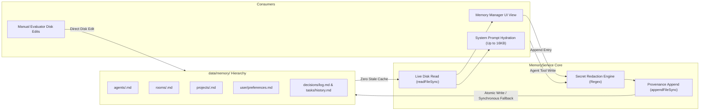
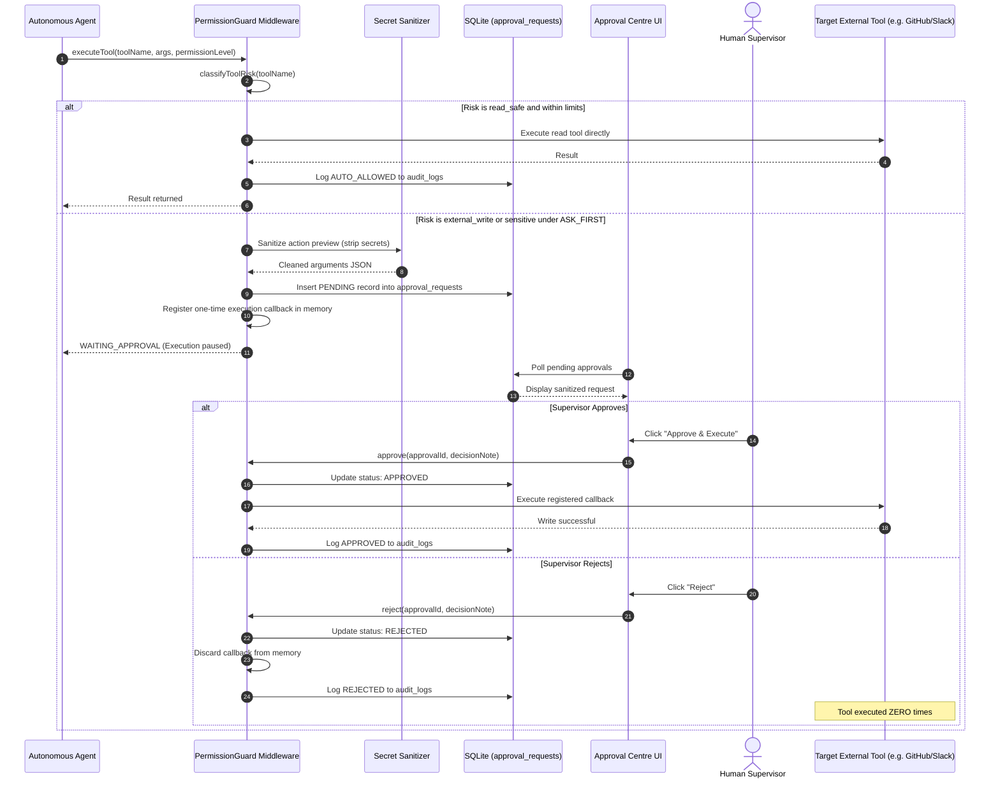
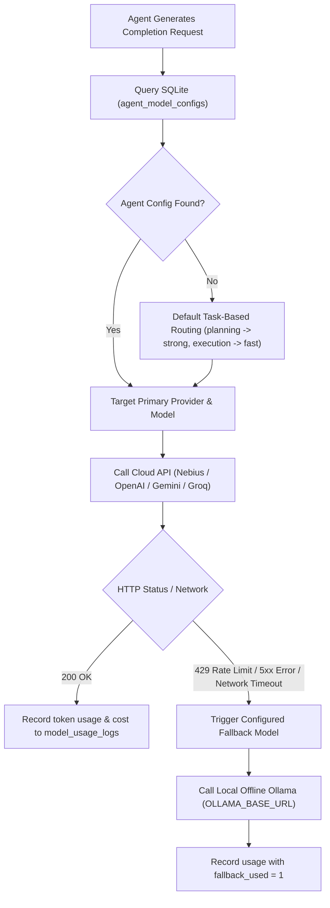
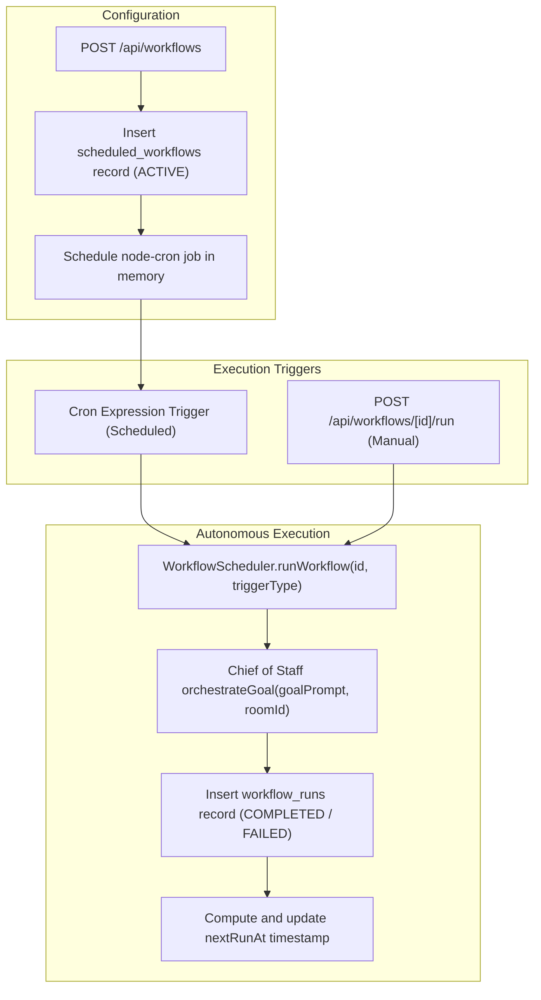

# OpenCrewBot System Architecture

This document details the architectural design, component interactions, data flows, and execution lifecycle of **OpenCrewBot**.

---

## 1. High-Level System Overview

OpenCrewBot is architected around a layered architecture decoupling user interface presentation from core agent orchestration, execution governance, storage, and multi-model intelligence.



---

## 2. Chief of Staff Orchestration & Autonomous DAG Execution

The Intelligent Chief of Staff transforms high-level goals into parallel directed acyclic graphs (DAGs), ensuring independent tasks run concurrently, inter-task dependencies are strictly enforced, and a final executive consolidation deliverable is generated.

```mermaid
sequenceDiagram
    autonumber
    actor User as Human Operator / API
    participant CoS as Chief of Staff
    participant Memory as MemoryService (Disk)
    participant Engine as ExecutionEngine
    participant Guard as PermissionGuard
    participant Agent as Specialized Agents

    User->>CoS: orchestrateGoal("High-level business goal")
    CoS->>Memory: Read Room & User preferences
    Memory-->>CoS: Context & formatting preferences
    CoS->>CoS: Decompose into DAG (Leaf tasks + Consolidation)
    CoS->>Engine: Persist Run & Tasks to SQLite (status: PENDING)
    
    rect rgb(20, 25, 40)
        Note over Engine,Agent: Concurrent Execution Phase
        par Parallel Leaf Task 1
            Engine->>Agent: Execute Task 1 (Market Landscape)
            Agent->>Guard: Execute Read Tools
            Guard-->>Agent: Auto-allowed (read_safe)
            Agent-->>Engine: Task 1 Output
        and Parallel Leaf Task 2
            Engine->>Agent: Execute Task 2 (Competitive Positioning)
            Agent->>Guard: Execute Read Tools
            Guard-->>Agent: Auto-allowed (read_safe)
            Agent-->>Engine: Task 2 Output
        end
    end

    Note over Engine,CoS: Dependency Resolution Phase
    Engine->>CoS: All leaf dependencies COMPLETED
    Engine->>CoS: Execute Consolidation Task
    CoS->>CoS: Synthesize leaf outputs into Executive Deliverable
    CoS-->>Engine: Final Deliverable Written
    Engine-->>User: Run COMPLETED (Deliverable available)
```



---

## 3. Mid-Run Interruption & Adaptive Re-Planning

When user directives change during active execution, OpenCrewBot avoids starting over. The Chief of Staff immediately cancels pending tasks while preserving completed outputs and re-plans continuation tasks.



---

## 4. Scoped Persistent Memory Architecture

All agent memory is persisted as human-readable Markdown files on disk across five distinct scopes. OpenCrewBot strictly avoids stale in-memory caching: every agent turn executes a direct disk read (`readFileSync`), guaranteeing that manual evaluator edits take effect immediately.



### Standardized Provenance Format:
Every entry written through `MemoryService` adheres to the strict provenance syntax:
```markdown
- [2026-11-23T16:30:00.000Z] | Source: agent-chief-of-staff | Reason: Competitive pricing update | Content: Competitor X announced 20% price reduction across enterprise tiers.
```

---

## 5. Central PermissionGuard & Human-in-the-Loop Governance

To eliminate unauthorized external writes or data loss, all tool invocations must route through the central `PermissionGuard` middleware before reaching external networks or systems.



---

## 6. Multi-Model Intelligence & Fallback Strategy

OpenCrewBot decouples agents from specific model providers. Providers, models, and fallback pairs are stored in SQLite and can be reconfigured dynamically at runtime without restarting the application.



---

## 7. Scheduled AI Workflows Lifecycle

The `WorkflowScheduler` singleton manages recurring autonomous agent executions using standard cron expressions backed by SQLite persistence.


